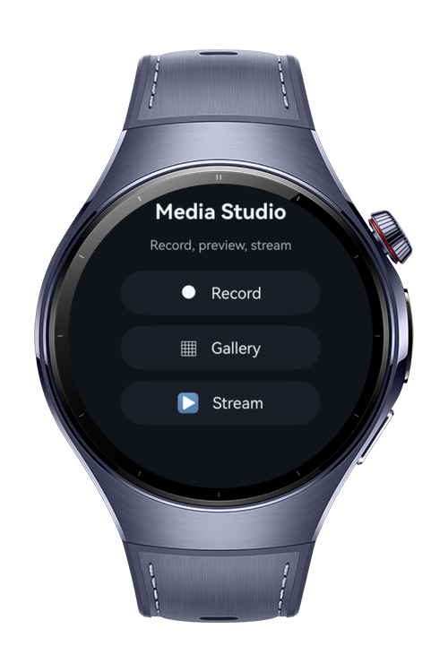
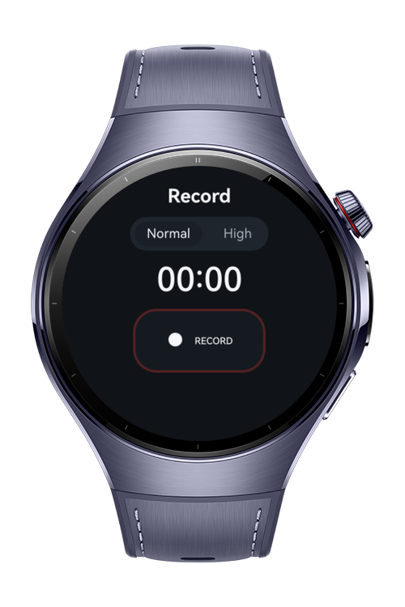
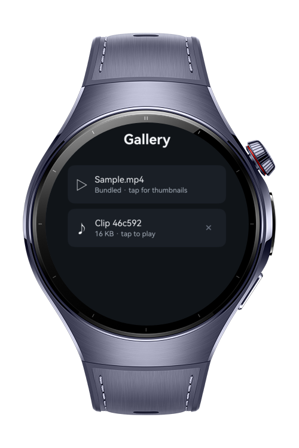
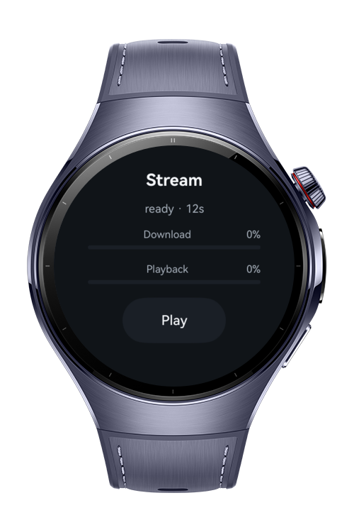

> **Note:** To access all shared projects, get information about environment setup, and view other guides, please visit [Explore-In-HMOS Index](https://github.com/Explore-In-HMOS/hmos-index).

# How To Build Media Creation Studio

**How To Build Media Creation Studio** is a HarmonyOS wearable codelab that demonstrates the
MediaKit capture, preview, and custom-source playback pipeline on the wrist.

The recorder flow is scoped to audio capture for wearable and simulator compatibility; the
video APIs are demonstrated with a bundled MP4 source.

It covers three MediaKit modules in one workflow:

- `media.AVRecorder` records voice notes as AAC inside an M4A container, then replays the
  saved sandbox clip with `AVPlayer`.
- `media.AVImageGenerator` extracts preview frames from a bundled MP4 at 8/36/64/90 % of its
  duration.
- `media.MediaSourceLoadingRequest` implements the progressive loader delegate used by
  `AVPlayer.setMediaSource()` in the stream demo.

# Preview

<div>
  
  
  
  
</div>

# Use Cases

- **Voice notes:** Record a clip on the wrist with a selectable AAC profile, save it to
  the app sandbox, and play it back from Gallery.
- **Frame previews:** Extract four wearable-sized thumbnails from a bundled MP4 with
  AVImageGenerator.
- **Progressive playback:** Serve the same MP4 through a custom MediaSourceLoadingRequest
  loader — the download indicator fills as the loader delivers the asset, then the playback
  indicator advances over the clip duration.

# Technology

## Stack

- **Languages**: ArkTS, ArkUI
- **Frameworks**: HarmonyOS SDK 6.0.1
- **Tools**: DevEco Studio NEXT
- **Libraries**:
  - `@kit.MediaKit`
  - `@kit.AudioKit`
  - `@kit.ImageKit`
  - `@kit.ArkUI`
  - `@kit.PerformanceAnalysisKit`

## Required Permissions

- `ohos.permission.MICROPHONE`
  > Needed by AVRecorder to capture voice notes.

# Directory Structure

```text
entry/src/main/ets/
├── components/
│   └── PrimaryActionButton.ets
├── constants/
│   └── MediaConfig.ets
├── entryability/
│   └── EntryAbility.ets
├── entrybackupability/
│   └── EntryBackupAbility.ets
├── model/
│   └── ClipEntry.ets
├── pages/
│   ├── Index.ets
│   ├── RecordPage.ets
│   ├── GalleryPage.ets
│   ├── AudioClipPage.ets
│   ├── ThumbnailsPage.ets
│   └── StreamPage.ets
├── services/
│   ├── AudioClipPlayerService.ets
│   ├── ClipSelectionService.ets
│   ├── ClipRepository.ets
│   ├── PermissionService.ets
│   ├── RecorderService.ets
│   ├── StreamSourceService.ets
│   └── ThumbnailService.ets
└── utils/
    └── SecureRandom.ets

entry/src/main/resources/rawfile/
└── sample.mp4
```

# Constraints and Restrictions

## Supported Devices

- Huawei Watch 5
- DevEco Studio Simulator

The thumbnail extraction and progressive stream demos use the bundled
`resources/rawfile/sample.mp4`. Voice recording requires the microphone permission to be
granted on first use.

# License

**How To Build Media Creation Studio** is distributed under the terms of the MIT License.

See the [LICENSE](/LICENSE) for more information.
